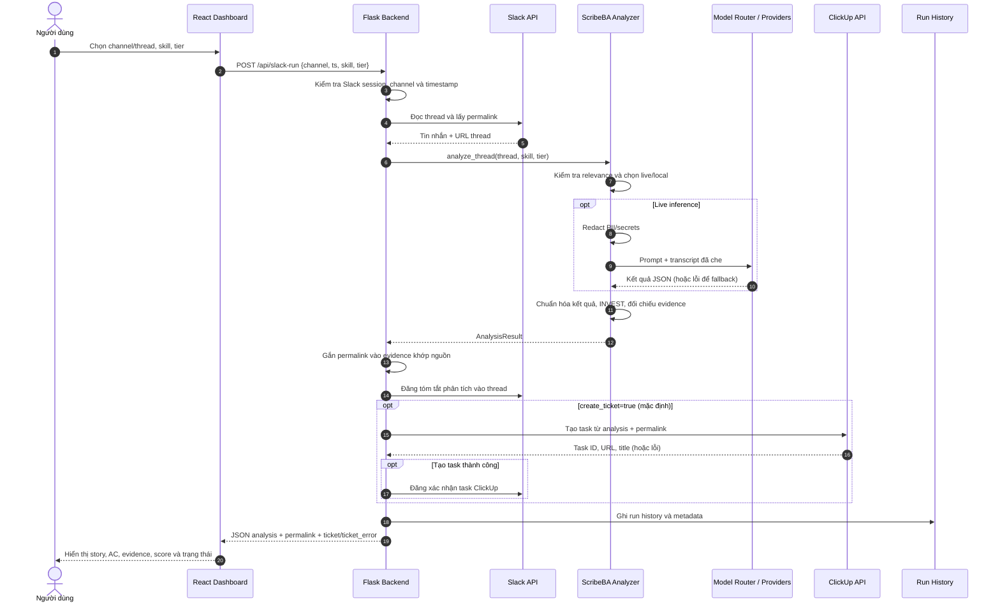
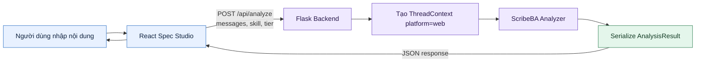

# Luồng AI ↔ Backend trong ScribeBA

Sơ đồ chính mô tả dashboard yêu cầu backend chạy AI trên một Slack thread thật. Nhánh Web Studio dùng `/api/analyze` và chỉ trả kết quả phân tích, không tự đọc Slack hay tạo ClickUp task.

### Nhánh Web Studio

### Lưu ý về hợp đồng hiện tại

- `/api/slack-run` cần Slack được ủy quyền trong browser session; backend đọc thread trước khi gọi analyzer.
- `create_ticket` mặc định là `true`. Lỗi ClickUp được trả trong `ticket_error`; phân tích vẫn được trả về.
- `ready_for_ticket` và câu hỏi làm rõ nằm trong kết quả AI; endpoint hiện vẫn thử tạo task khi `create_ticket=true`.
- Run history được ghi sau bước đăng summary và lần thử tạo task.

### Mã nguồn liên quan

- `backend/api.py`: `/api/slack-run`, `/api/analyze`, serialization và ghi run.
- `backend/platforms/slack_adapter.py`: đọc thread/permalink, đăng summary và xác nhận.
- `backend/core/analyzer.py`: xử lý AI.
- `backend/integrations/clickup_client.py`: tạo task từ kết quả phân tích.
