# Luồng xử lý AI trong ScribeBA

Sơ đồ đặt luồng chính theo chiều ngang. Exa được vẽ thành nhánh grounding tùy chọn: code hiện có `ExaClient` và lệnh CLI tìm kiếm/grounding, nhưng analyzer chưa tự gọi Exa trong mỗi lần phân tích.

```mermaid
flowchart LR
    IN["Thread hội thoại<br/>Slack hoặc Web Studio"] --> REL{"Có quyết định<br/>hoặc yêu cầu sản phẩm?"}
    REL -- "Không" --> EMPTY["Trả kết quả rỗng / Blocked<br/>Gắn nguồn tin nhắn"]
    REL -- "Có" --> MODE{"Chế độ live<br/>và có API key?"}

    MODE -- "Local" --> LOCAL["Local engine<br/>phân tích transcript"]
    MODE -- "Live" --> REDACT["Ẩn PII và secret<br/>trước khi gửi ra ngoài"]
    REDACT --> PROMPT["Tạo ngữ cảnh cho model"]
    PROMPT --> ROUTER["ModelFallbackRouter<br/>thử provider theo tier"]
    ROUTER --> VALID{"Có JSON<br/>hợp lệ?"}
    VALID -- "Có" --> PARSE["Chuẩn hóa story,<br/>AC, tasks, evidence"]
    VALID -- "Không / timeout" --> HIGH{"Tier = high?"}
    HIGH -- "Có" --> FILTER["NoiseFilterAgent<br/>lọc tin ngoài lề"]
    FILTER --> DECOMP["TaskDecompositionAgent<br/>tách task và owner"]
    DECOMP --> SYNTH["AgileSynthesizerAgent<br/>tạo story, AC, câu hỏi"]
    SYNTH --> AUDIT["ProvenanceAuditorAgent<br/>kiểm tra evidence và noise"]
    AUDIT --> SCORE["Tính điểm INVEST"]
    HIGH -- "Không" --> LOCAL
    LOCAL --> SCORE
    PARSE --> SCORE
    SCORE --> SOURCE["Đối chiếu quote với thread gốc<br/>Khớp rõ thì gắn nguồn;<br/>mơ hồ thì unmatched"]
    SOURCE --> OUT["AnalysisResult / JSON"]
    EMPTY --> OUT

    subgraph EXA_BRANCH["GROUNDING TÙY CHỌN · EXA CHƯA NỐI TỰ ĐỘNG VÀO ANALYZER"]
        direction LR
        QUERY["Câu hỏi về RFC,<br/>API hoặc chuẩn ngoài"] --> EXA["Exa semantic search"]
        EXA --> HIGHLIGHTS["Kết quả liên quan<br/>+ highlights + URL nguồn"]
    end
    REDACT -. "chỉ khi bật grounding" .-> QUERY
    HIGHLIGHTS -. "ngữ cảnh để model đối chiếu" .-> PROMPT

    classDef input fill:#e8f1ff,stroke:#3777c6,color:#10233f
    classDef ai fill:#efe9ff,stroke:#7955c7,color:#28184b
    classDef guard fill:#fff4d6,stroke:#c18b15,color:#49370a
    classDef output fill:#e4f6eb,stroke:#38845a,color:#123b24
    classDef exa fill:#e0f7f4,stroke:#129382,color:#103d3a,stroke-dasharray:5 3
    class IN input
    class REL,MODE,VALID,HIGH guard
    class REDACT,PROMPT,ROUTER,PARSE,FILTER,DECOMP,SYNTH,AUDIT,LOCAL,SCORE,SOURCE ai
    class QUERY,EXA,HIGHLIGHTS exa
    class EMPTY,OUT output
```

## Exa có lợi gì ở luồng này?

- **Bổ sung kiến thức bên ngoài hội thoại:** khi team nhắc OAuth, RFC, API vendor hoặc chuẩn bảo mật, Exa có thể tìm tài liệu liên quan để model đối chiếu thay vì chỉ dựa vào trí nhớ huấn luyện.
- **Tìm theo ý nghĩa:** semantic search có thể tìm tài liệu dùng cách diễn đạt khác với câu hỏi, hữu ích khi thread mô tả một vấn đề nhưng không nêu đúng tên chuẩn/tài liệu.
- **Giữ căn cứ để kiểm tra:** client của dự án lấy highlights và URL. Model có thể dùng trích đoạn liên quan, còn người đọc mở nguồn để xác nhận yêu cầu/acceptance criteria.
- **Giảm suy đoán trong phần kỹ thuật:** nguồn RFC hoặc tài liệu chính thức giúp làm rõ edge cases và constraints trước khi sinh task hay test scenario.

Exa chỉ tìm và cung cấp nguồn; kết quả tìm kiếm không tự chứng minh một yêu cầu là đúng. Nên ưu tiên RFC và tài liệu chính thức, rồi để người dùng kiểm tra các quyết định quan trọng. Exa semantic search tìm theo ý nghĩa thay vì chỉ khớp nguyên văn; [hướng dẫn của Exa](https://exa.ai/blog/what-is-semantic-search) mô tả cách tiếp cận này.

## Trạng thái trong dự án

- `backend/integrations/exa_client.py` triển khai tìm kiếm `/search`, trả title, URL, highlights và có hàm `ground_ai_test_spec`.
- `backend/cli.py` cung cấp `exa-search` và `exa-test` để tra cứu/grounding thủ công.
- `backend/core/analyzer.py` hiện chưa gọi `ExaClient`; vì vậy nhánh Exa trong sơ đồ là tùy chọn/đề xuất nối thêm, không phải bước chạy tự động.
- Bộ định tuyến thử các model/provider theo tier; nếu model ngoài không dùng được, analyzer có local fallback. Tier `high` có thể chạy pipeline nhiều agent.

## Mã nguồn liên quan

- `backend/core/analyzer.py`: relevance gate, chọn live/local, parse, INVEST và gắn nguồn.
- `backend/core/fallback_router.py`: cascade model/provider và local fallback.
- `backend/core/multi_agent.py`: pipeline 4 agent cho nhánh tier `high`.
- `backend/core/redaction.py`: che PII/secret trước model egress.
- `backend/integrations/exa_client.py`: Exa Search và grounding helper.
